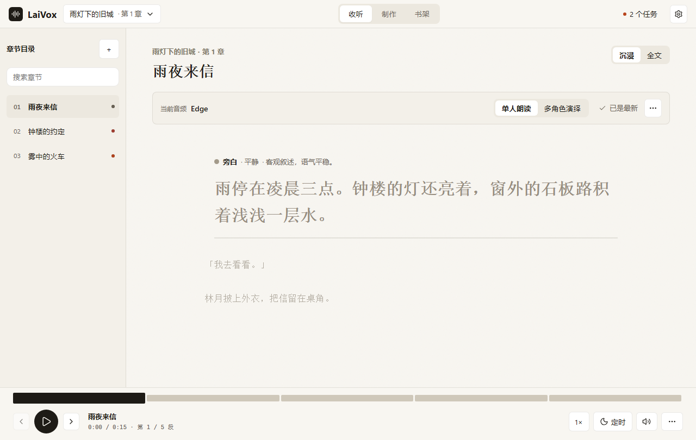
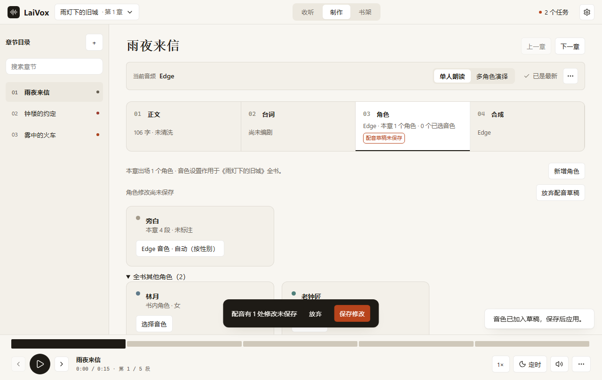
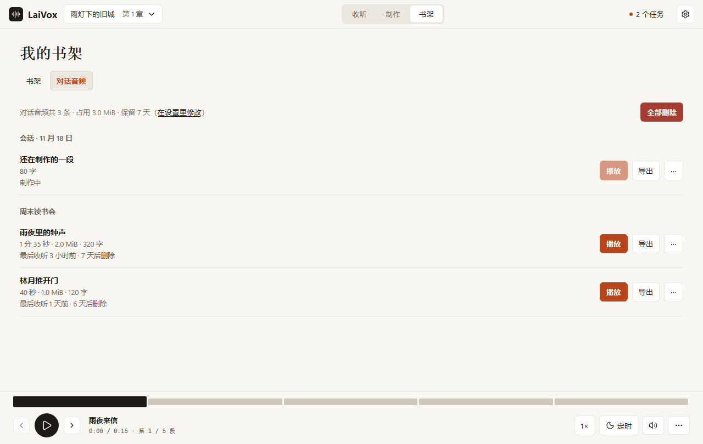
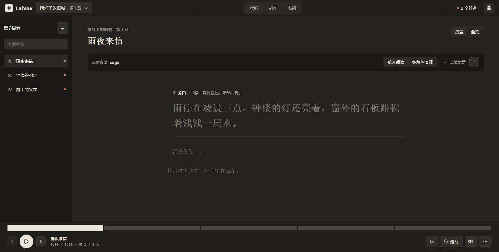

# Novel voices (LaiVox)

**English** · [简体中文](README.zh-CN.md)

An audiobook plugin for [DeepSeek Harness](https://github.com/deepseek-ai/deepseek-harness) (DSH). Turn TXT, EPUB, and text-based PDF novels into narrated or multi-voice audio, or have DSH read its replies aloud. It uses Microsoft Edge online voices by default, so no account or sign-up is needed.



> The plugin's interface is in Chinese and it is built for Chinese text (Simplified and Traditional). Read-aloud also handles English. The Chinese labels below are the ones you will see on screen.

## What you can do

- **Listen to a novel you have.** Import a TXT, EPUB, or text-based PDF file. Chapters are detected for you and shown in a preview before anything is saved. Pick a chapter and press 开始制作 (Start). Playback can start as soon as the first segment is ready.
- **Give each character a voice.** Choose 多角色演绎 (multi-voice) instead of 单人朗读 (single narrator). Your DSH model marks who is speaking and in what tone, and each role gets its own voice. You see the expected number of model requests and confirm before any model call. Edge changes the voice per role but does not perform the per-line delivery; that requires LaiVox.
- **Use LaiVox voices (optional).** Under Settings → 制作与发声 (Production and voice), switch the engine to LaiVox. That choice is marked recommended; Edge stays the default. LaiVox reads each line with its marked delivery. When the account has own voices enabled, voices uploaded in the LaiVox browser extension can be assigned to roles. LaiVox uses a membership reading allowance or a separately purchased read-aloud pack, and needs an API key.
- **Let the AI do the setup.** In chat, say "turn book.txt in my workspace into an audiobook". The AI prepares an import preview and a production order under its reply. Nothing is imported or produced until you click confirm, and AI jobs queue behind yours instead of interrupting them.
- **Hear a reply instead of reading it.** Click the speaker button 用 Edge 朗读 under any assistant message, or ask "read it to me". Closed code blocks and link addresses are skipped. Table cells are read.
- **Quick snippets.** Type `/laivox some text` in the chat box to turn a passage into audio. The results are kept under 书架 → 对话音频 (Bookshelf → Chat audio).
- **Take it with you.** Download a chapter as MP3 or WAV, or export a whole book as a ZIP of MP3 or WAV files.

Step-by-step walkthroughs of each scenario are in the [user guide](docs/GUIDE.md) (Chinese).

| Roles and voices | Import preview | Chat audio | Dark theme |
|---|---|---|---|
|  |  |  |  |

## Install

You need the `dsh` command:

- **DSH Desktop**: in the application menu, choose **Manage dsh Command… → Install** (just below **Check for Updates…**). Open a new terminal and run `dsh --version`. Desktop's profile is named `desktop`. Launch Desktop once before installing, then **fully quit it** (including from the system tray) before running the commands below. See the [official Desktop docs](https://github.com/deepseek-ai/deepseek-harness/blob/38a6a5c/apps/desktop/README.md#terminal-command).
- **DSH Web / CLI**: requires Node.js 24.9 or later. The examples below use a profile named `web`.

Replace `desktop` with your own profile name wherever needed.

### Remote: install from the latest release (recommended)

```sh
dsh plugin --profile desktop add "https://github.com/xiaolai181/dsh_laivox_tts/releases/latest/download/dsh-laivox-tts.tgz"
```

This is a prebuilt package. Nothing is compiled on your machine and no build permission is asked for. To pin a version, replace `latest/download` with `download/v0.7.7`. Other versions are listed on the [Releases](https://github.com/xiaolai181/dsh_laivox_tts/releases) page.

### Local: install a downloaded package

Download `dsh-laivox-tts.tgz` from [Releases](https://github.com/xiaolai181/dsh_laivox_tts/releases), then run this in the folder that contains it:

```sh
dsh plugin --profile desktop add ./dsh-laivox-tts.tgz
```

This works offline, for example on a machine without GitHub access.

### Local: install from a source folder (for developers)

```sh
git clone https://github.com/xiaolai181/dsh_laivox_tts.git laivox-tts
cd laivox-tts
npx pnpm install          # pnpm is required; this also builds lib/
dsh plugin --profile desktop add .
```

The profile links to this folder, so keep it where it is. After `git pull`, run `npx pnpm install` again to rebuild.

> **Switching from a source folder to a package install:** after `dsh plugin remove`, a link named `dsh-laivox-tts` is left in the profile's `node_modules`. Delete that link first, and only the link (on Windows: `rmdir` without `/s`). Otherwise the next install may delete files inside your source folder.

### After installing

- **Desktop**: reopen DeepSeek Harness. **Web**: restart `dsh web`.
- The plugin appears in the sidebar as **小说配音（LaiVox）** (Novel voices).
- Check what is installed: `dsh plugin --profile desktop list`

### Update and uninstall

- **Update**: run the same install command again. A `latest/download` link fetches the newest release.
- **Uninstall**: `dsh plugin --profile desktop remove dsh-laivox-tts`. Your books and audio stay on disk (see [Your data](#your-data)).

## First five minutes

Choose the workbench language in **DSH Settings → General → Language**. LaiVox supports Simplified Chinese, Traditional Chinese, and English.

1. Open **小说配音（LaiVox）** from the sidebar. The workbench has three tabs: 收听 (Listen), 制作 (Produce), and 书架 (Bookshelf). Tasks and settings are at the top right.
2. Go to **书架 → 导入 TXT / EPUB / PDF** and pick a file. If the chapter split looks wrong, click a chapter title to adjust it, then confirm the import.
3. Open a chapter, choose **单人朗读** (single narrator) and press **开始制作**. This uses no AI.
4. Press play once the first segment is ready. Speed, sleep timer, bookmarks and follow-along highlighting are in the player. The next chapter plays automatically; you can turn this off in settings.

To paste text instead of importing a file, use **书架 → 新建书籍** (New book).

When opened on a fresh, empty profile for the first time, the bookshelf starts with two playable sample books: 社戏 · 月夜行船 · Edge (generated with Microsoft Edge online speech for single-narrator reading) and 绿野仙踪 · 营救铁皮人 · LaiVox (generated with LaiVox preset voices for multi-role performance). No API key is needed to listen or export them.

## Privacy and cost

- **Edge voices** are the built-in online voices and need no account. The text being voiced is sent to Microsoft's online Edge speech service via an unofficial protocol; availability and terms of use are governed by Microsoft and are not guaranteed by this project.
- **AI features** (cleanup, multi-voice scripting, AI-assisted chapter splitting) use the model you configured in DSH and count against that model's quota. Every such step shows the expected requests and waits for your confirmation. Single-narrator reading never calls a model.
- **The LaiVox engine** is an optional paid add-on. It draws on a membership reading allowance or a separately purchased read-aloud pack. Choose it under Settings → 制作与发声 (Production and voice) and save the API key. Text submitted for synthesis is sent to the LaiVox service and handled under its service and retention policies. The reading allowance is shared with the LaiVox browser extension. A read-aloud pack or a quota pool ends when it is used up or expires. Only an older membership account that is still billed by usage day can open the next day, and only after you confirm. You can also finish the chapter with Edge. When the account has own voices enabled, voices uploaded in the browser extension can be given to roles; uploading and editing them stay in the extension. The key is stored in DSH's credential service, and the plugin only contacts LaiVox while you use it.
- **Content rights**: import and synthesize only texts that you own or are legally permitted to process. Generated audio is for personal, lawful use.
- The AI can read files only in the current chat's workspace, and it cannot delete your books.

## Your data

Everything stays on your machine, in the profile folder: `<DSH home>/profiles/<profile>/dsh-laivox-tts/`. The default DSH home is `~/.dsh`. A single `library.sqlite` holds the bookshelf, scripts, tasks, audio and playback positions.

- **Back up before upgrading**: fully quit DSH and copy the whole `dsh-laivox-tts` folder. A newer version may upgrade the database (currently v12), and older versions can no longer open it.
- **Audio budget**: 2 GiB by default, adjustable from 0.5 to 20 GiB under 设置 → 存储 (Settings → Storage). The new limit applies after you reopen DSH. When space runs out, new production pauses. You can clear audio by book or chapter, and text and scripts are kept.
- **Chat audio** that has not been played for 7 days is deleted automatically. You can change this to 1 day, 30 days or never. Saving it to the bookshelf keeps it permanently.
- **Built-in sample books** are seeded once on a fresh, empty profile (existing profiles with books are untouched when upgrading). You can delete them at any time and they will not reappear on restart or upgrade.
- To wipe everything, uninstall the plugin and delete the `dsh-laivox-tts` folder.

## Known limitations

- Confirmation buttons, import previews and results appear only under the latest reply, not under earlier ones.
- The first read-aloud sentence takes about 2 seconds. Later sentences take 0.5 to 1 second.
- If the same chat is open in two windows, AI-started read-aloud plays in both.
- A single import file is limited to 50 MiB. An EPUB may expand to at most 150 MiB, and each file inside it to 32 MiB. A PDF is limited to 5,000 pages or 30 million characters. A book can have at most 5,000 chapters.

## License

The LaiVox plugin code is released under the [MIT License](LICENSE). The LaiVox TTS server and access to it are not covered. The LaiVox brand, icons and preset voice samples are under their own terms. See [Third-party notices](THIRD_PARTY_NOTICES.md).
