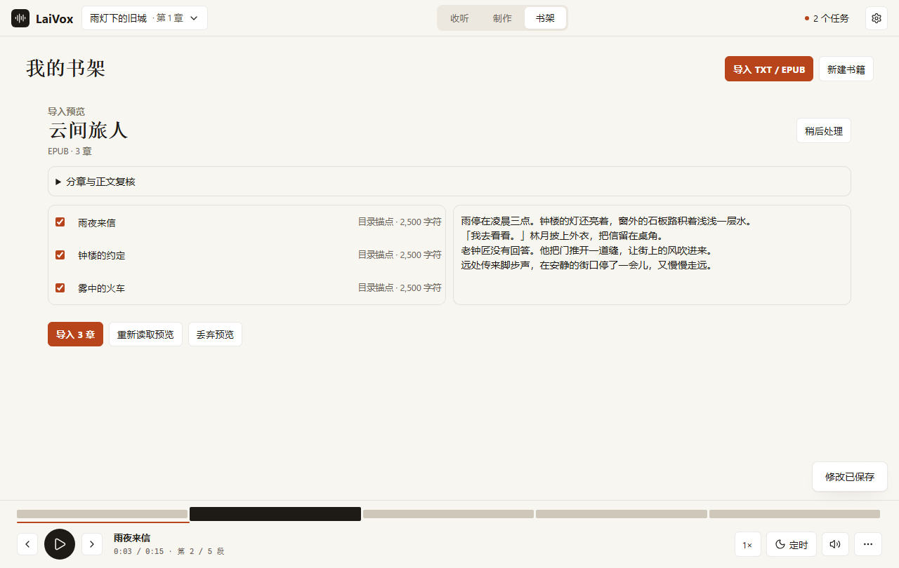

# Novel voices (LaiVox)

**English** · [简体中文](README.zh-CN.md)

An audiobook plugin for [DeepSeek Harness](https://github.com/deepseek-ai/deepseek-harness) (DSH). Turn TXT, EPUB, and PDF novels into single-voice or multi-voice audiobooks, or have AI replies read aloud with one click. Built-in Microsoft Edge online voices work out of the box with no account required, and the workbench supports Simplified Chinese, Traditional Chinese, and English.


## What you can do

- **Turn books into audio**: Import TXT, EPUB, or PDF novels with automatic chapter detection and preview, or paste text into a new book. Pick a chapter and press **Start production**—playback begins as soon as the first segment is ready.
- **Single-voice or multi-voice narration**: **Single voice** works immediately without AI. Switch to **Multi-voice narration** to let your configured DSH model identify speakers and tone and assign a distinct voice to each role. You see the expected request count and confirm before any model call. Edge switches voices per role, while per-line expressive delivery uses LaiVox.
- **Use LaiVox expressive voices (optional)**: Under **Settings → Production & Voice Engine**, switch the engine to LaiVox for per-line expressive delivery and access to **My voices** uploaded in the LaiVox browser extension. Requires an API key backed by a LaiVox membership reading allowance or a separately purchased read-aloud pack.
- **Let AI help organize and queue**: Ask AI in chat to turn a book in your workspace into an audiobook. It prepares an import preview and a production plan below its reply, waits for your confirmation, and queues AI jobs behind your own without interrupting active playback or production.
- **Read AI replies and quick snippets aloud**: Click **Read aloud with Edge** next to any assistant message, or ask the assistant to read aloud (code blocks and URLs are skipped, table cells are read). You can also send `/laivox some text` to voice a passage—results stay organized under **Bookshelf → Chat audio**.
- **Export for offline listening**: Download a single chapter as MP3 or WAV, or export an entire book as a ZIP archive of chapter audio files.

Step-by-step walkthroughs are in the [user guide](docs/GUIDE.md) (Chinese).

| Roles and voices | Import preview | Chat audio | Dark theme |
|---|---|---|---|
|  |  |  |  |

## Install

Make sure the `dsh` command is available:

- **DSH Desktop**: open the application menu and choose **Manage dsh Command… → Install** (below **Check for Updates…**). Open a new terminal and run `dsh --version` to verify. Desktop uses the `desktop` profile. Launch Desktop once before installing, then **fully quit it** (including from the system tray) before running the commands below. See the [official Desktop docs](https://github.com/deepseek-ai/deepseek-harness/blob/38a6a5c/apps/desktop/README.md#terminal-command).
- **DSH Web / CLI**: requires Node.js 24.9 or later. Replace `desktop` with `web` (or your own profile name) in the commands below.

### Online install (recommended)

```sh
dsh plugin --profile desktop add "https://github.com/xiaolai181/dsh_laivox_tts/releases/latest/download/dsh-laivox-tts.tgz"
```

This installs a prebuilt package—nothing is compiled locally and no install scripts run. To pin a specific version, replace `latest/download` with `download/v0.7.12` (see [Releases](https://github.com/xiaolai181/dsh_laivox_tts/releases)).

### Offline package install

Download `dsh-laivox-tts.tgz` from [Releases](https://github.com/xiaolai181/dsh_laivox_tts/releases) and run this in the folder containing it:

```sh
dsh plugin --profile desktop add ./dsh-laivox-tts.tgz
```

Useful when the machine does not have direct GitHub access.

<details>
<summary>Install from a source folder (for developers)</summary>

```sh
git clone https://github.com/xiaolai181/dsh_laivox_tts.git laivox-tts
cd laivox-tts
npx pnpm install          # pnpm is required; this also builds lib/
dsh plugin --profile desktop add .
```

The profile links directly to this folder, so keep it in place. After `git pull`, run `npx pnpm install` again to rebuild.

> **Switching back from a source install to a release package**: after `dsh plugin remove`, a `dsh-laivox-tts` link remains inside the profile's `node_modules`. Remove only that link (on Windows, use `rmdir` without `/s`) before reinstalling so files in your source folder are not deleted.

</details>

### After installing

- **Desktop**: reopen DeepSeek Harness. **Web**: restart `dsh web`.
- **Novel voices (LaiVox)** appears in the sidebar.
- Verify installed plugins with `dsh plugin --profile desktop list`.

### Update and uninstall

- **Update**: run the install command again (`latest/download` pulls the newest release).
- **Uninstall**: run `dsh plugin --profile desktop remove dsh-laivox-tts`. Your books and audio remain on disk.

## First five minutes

Choose your preferred language under **DSH Settings → General → Language** (Simplified Chinese, Traditional Chinese, or English).

1. Open **Novel voices (LaiVox)** from the sidebar. The workbench has three tabs: **Listen**, **Produce**, and **Bookshelf**, with tasks and settings in the top right.
2. On a fresh empty profile, first launch places two ready-to-play sample books on your bookshelf—a single-voice Edge sample and a multi-voice LaiVox sample—so you can listen right away without an API key and delete them anytime.
3. Go to **Bookshelf → Import TXT / EPUB / PDF** to pick a novel (or click **New book** to paste text). Adjust chapter splits if needed and confirm the import.
4. Open a chapter, select **Single voice**, and click **Start production** (no AI required). Playback starts once the first segment is ready, with speed control, sleep timer, bookmarks, follow-along highlighting, and optional auto-advance to the next chapter.

## Privacy and cost

- **Microsoft Edge online voices**: Built in as the default with no account needed. Text being voiced is sent to Microsoft's online Edge speech service; availability and terms are governed by Microsoft.
- **AI features**: Text cleanup, multi-voice scripting, and AI chapter detection use the model configured in DSH and count against that model's quota. Every step displays the expected request count and waits for your confirmation. **Single voice** never calls a model.
- **LaiVox engine (optional add-on)**: Enable under **Settings → Production & Voice Engine** with an API key backed by a membership reading allowance or a separately purchased read-aloud pack. Text submitted for synthesis is sent to the LaiVox service under its service and retention policies. The API key is stored in DSH's credential store and LaiVox is only contacted when you use it. Uploading and editing custom voices stay in the LaiVox browser extension.
- **Rights and boundaries**: Import and voice only texts you own or are legally permitted to use; generated audio is for personal, lawful use. The AI assistant can only read files inside the current chat workspace and cannot delete books from your bookshelf.

## Local data and storage

Your bookshelf, text, scripts, and audio stay on your machine:

- **Audio storage limit**: 2 GiB by default, configurable from 0.5 to 20 GiB under **Settings → Storage** (takes effect after reopening DSH). Production pauses if the limit is reached; you can clear audio per book or chapter while keeping text and scripts intact.
- **Chat audio retention**: Unplayed chat audio expires after 7 days by default (configurable to 1 day, 30 days, or never). Saving a clip to the bookshelf keeps it permanently.
- **Complete removal**: Uninstall the plugin and delete its plugin data folder to wipe all local files.

<details>
<summary>Data folder and backup notes before upgrading</summary>

- All plugin data lives in `<DSH home>/profiles/<profile>/dsh-laivox-tts/` (default DSH home: `~/.dsh`), with `library.sqlite` storing your bookshelf, scripts, jobs, audio, and playback progress.
- **Back up before upgrading**: fully quit DSH and copy the entire `dsh-laivox-tts` folder. A newer release may upgrade the local database schema (currently v12), which older plugin versions cannot open.
- Built-in sample books are seeded only once on a fresh empty profile (existing profiles with books are untouched on upgrade) and will not reappear after deletion.

</details>

<details>
<summary>File limits and usage notes</summary>

- **PDF support**: Text-based PDFs are supported; image-only scanned PDFs are not supported.
- **Import limits**: Up to 50 MiB per file; EPUB archives up to 150 MiB uncompressed (32 MiB per internal file); PDFs up to 5,000 pages or 30 million characters; up to 5,000 chapters per book.
- **Chat behavior**: Confirmation controls, import previews, and outcomes appear only below the latest reply. The first read-aloud sentence usually takes 1–2 seconds to start (0.5–1 second for subsequent sentences). If the same chat is open in two windows, AI-triggered read-aloud plays in both.

</details>

## License

The LaiVox plugin code is released under the [MIT License](LICENSE). The LaiVox TTS server and access to it are not covered. The LaiVox brand, icons and preset voice samples are under their own terms. See [Third-party notices](THIRD_PARTY_NOTICES.md).
