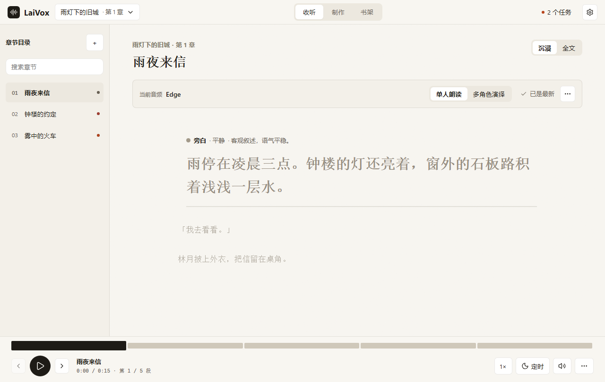
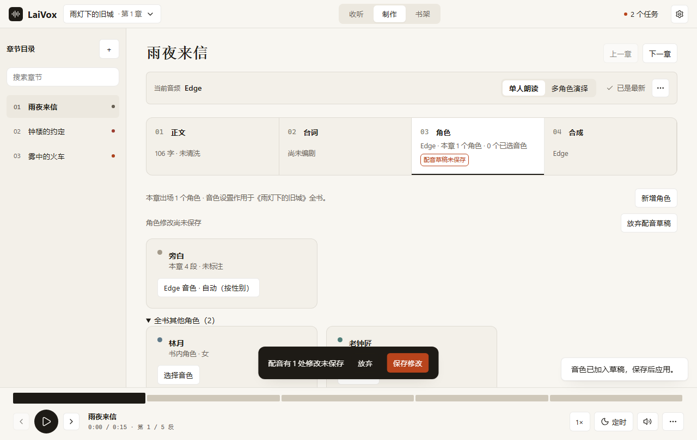
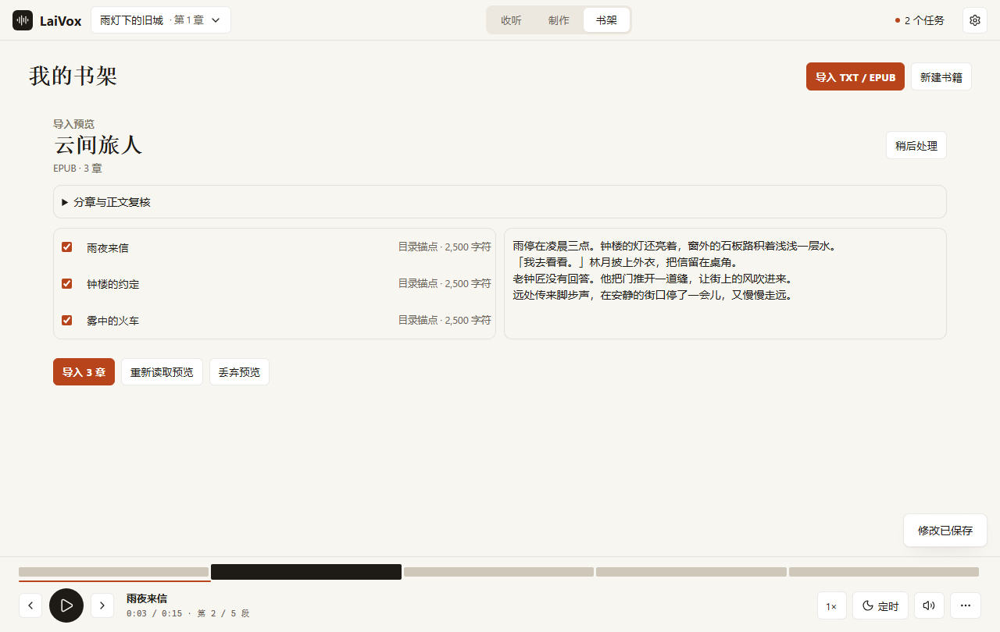
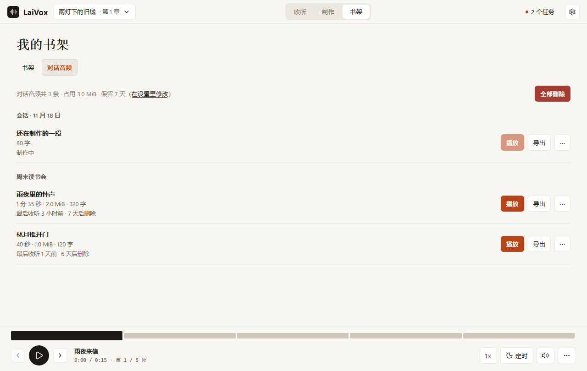
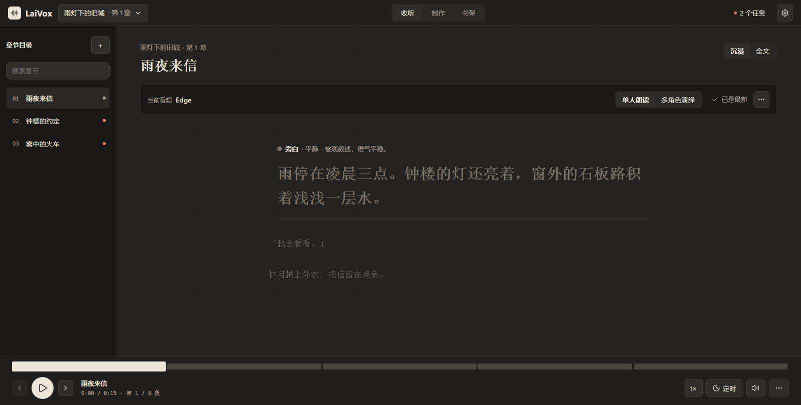

# 小说配音（LaiVox）

[English](README.md) · **简体中文**

[DeepSeek Harness](https://github.com/deepseek-ai/deepseek-harness)（DSH）的有声书插件：把 TXT、EPUB、PDF 小说做成单人朗读或多角色有声书，也能一键把 AI 的回答读给你听。默认内置微软 Edge 在线语音，无需注册账号，支持简体中文、繁体中文与英文。



## 你能用它做什么

- **听手里的小说**：导入 TXT、EPUB 或 PDF，自动分章并预览目录；也可以直接新建书籍粘贴正文。选好章节点击「开始制作」，第一段完成即可开听，不用等整章做完。
- **单人朗读，或多角色配音**：单人朗读开箱即用；选择「多角色演绎」后，由你在 DSH 中配置的模型分辨说话人和语气，为每个角色分配独立音色。开始前会列出预计请求数，由你确认后才调用模型。Edge 引擎会按角色切换不同音色，逐句情绪演绎需使用 LaiVox 引擎。
- **使用 LaiVox 拟人音色（可选）**：在设置的「制作与发声」中切换为 LaiVox。支持按每句语气做拟人化情感演绎，账号开通自有音色后，也可直接选用在 LaiVox 浏览器扩展里上传的「我的音色」。使用会员朗读额度或单独购买的朗读时长包，填入 API Key 即可启用。
- **让 AI 当你的有声书助手**：在对话里直接说“把工作目录里的 book.txt 做成有声书”，AI 会在回答下方准备好导入预览和制作计划。点击确认后才会导入与制作，且任务自动排在已有队列之后，不会打断你正在听或正在做的书。
- **一键听 AI 回答，随手朗读片段**：点击回答下方的「用 Edge 朗读」，或直接说“读给我听”，系统会自动跳过代码块与链接地址，并读出表格文字；在输入框发送 `/laivox 一段文字` 也能快速生成音频，结果收纳在「书架 → 对话音频」。
- **导出带走**：支持单章导出 MP3 / WAV，或将整本书打包导出为按章命名的 ZIP。

更完整的场景操作说明见 [使用指南](docs/GUIDE.md)。

| 角色与音色 | 导入预览 | 对话音频 | 深色主题 |
|---|---|---|---|
|  |  |  |  |

## 安装

安装前先准备好 `dsh` 命令：

- **DSH 桌面版**：在「应用程序」菜单中选「管理 dsh 命令…」→「安装」（位于「检查更新」下方），打开新终端执行 `dsh --version` 确认可用。桌面版的默认 Profile 名为 `desktop`。安装插件前请先启动一次桌面版，再**完全退出**（包括系统托盘），然后执行下方命令。详见 [官方桌面版文档](https://github.com/deepseek-ai/deepseek-harness/blob/38a6a5c/apps/desktop/README.zh.md#终端命令)。
- **DSH Web / 命令行版**：需要 Node.js 24.9 或更高版本，示例中使用 Profile 名 `web`。

如使用其他 Profile，将命令中的 `desktop` 替换为你的 Profile 名称即可。

### 在线安装（推荐）

```sh
dsh plugin --profile desktop add "https://github.com/xiaolai181/dsh_laivox_tts/releases/latest/download/dsh-laivox-tts.tgz"
```

安装的是预构建插件包，无需在本地编译或授权构建脚本。如需锁定版本，可将 `latest/download` 替换为 `download/v0.7.12`（全部版本见 [Releases](https://github.com/xiaolai181/dsh_laivox_tts/releases)）。

### 离线安装包安装

从 [Releases](https://github.com/xiaolai181/dsh_laivox_tts/releases) 下载 `dsh-laivox-tts.tgz`，在文件所在目录执行：

```sh
dsh plugin --profile desktop add ./dsh-laivox-tts.tgz
```

适合无法直连 GitHub 的离线或内网环境。

<details>
<summary>从源码目录安装（开发者）</summary>

```sh
git clone https://github.com/xiaolai181/dsh_laivox_tts.git laivox-tts
cd laivox-tts
npx pnpm install          # 必须使用 pnpm，安装时会自动构建 lib/
dsh plugin --profile desktop add .
```

Profile 会直接链接到该源码目录，安装后请勿移动或删除。执行 `git pull` 更新源码后，需再次运行 `npx pnpm install` 重新构建。

> **从源码安装改回插件包安装时**：执行 `dsh plugin remove` 后，Profile 的 `node_modules` 下仍会保留 `dsh-laivox-tts` 目录链接。请先只删除该链接本身（Windows 上使用不带 `/s` 的 `rmdir`），再安装插件包，避免误删源码目录内的文件。

</details>

### 安装完成后

- **桌面版**：重新打开 DeepSeek Harness。**Web 版**：重启 `dsh web`。
- 左侧栏会出现「小说配音（LaiVox）」。
- 可通过 `dsh plugin --profile desktop list` 查看安装状态。

### 更新与卸载

- **更新**：重新运行一次安装命令即可（使用 `latest/download` 会自动获取最新版）。
- **卸载**：运行 `dsh plugin --profile desktop remove dsh-laivox-tts`。已导入的书籍与生成的音频会保留在本机。

## 五分钟上手

可在 **DSH 设置 → 通用设置 → 语言** 中切换简体中文、繁体中文或英文，工作台会同步跟随。

1. 从侧栏打开「小说配音（LaiVox）」。工作台顶部有三个页签：**收听**、**制作**、**书架**，右上角为任务列表与设置。
2. 首次打开若书架为空，会自动放好两本免 Key 试听示例：《社戏 · 月夜行船 · Edge》（Edge 单人朗读）与《绿野仙踪 · 营救铁皮人 · LaiVox》（LaiVox 多角色配音），点开即可直接试听，不需要时可随时删除。
3. 在 **书架 →「导入 TXT / EPUB / PDF」** 选择小说文件（或点击「新建书籍」粘贴正文）。分章有误时可点击标题调整，确认后导入。
4. 打开章节，选择「单人朗读」并点击「开始制作」（无需调用 AI）；第一段生成完毕即可播放，支持倍速、定时关闭、书签、随读高亮与自动续播下一章（可在设置中关闭）。

## 隐私与费用

- **微软 Edge 在线语音**：默认内置，无需注册账号。待朗读或合成的文字会发送至微软 Edge 在线语音服务，服务可用性与条款受微软方约束。
- **AI 辅助功能**：正文清洗、多角色演绎编剧与 AI 辅助分章会使用你在 DSH 中配置的模型，并计入对应模型额度；每一步都会先展示预计请求数，经你确认后才会调用。单人朗读从不调用模型。
- **LaiVox 引擎（可选增值）**：在设置的「制作与发声」中开启并保存 API Key。支持使用会员朗读额度或单独购买的朗读时长包，合成文字会发送至 LaiVox 服务并按其隐私与保留策略处理；API Key 保存在 DSH 凭据服务中，仅在使用 LaiVox 时连接服务。自有音色的上传与管理仍在 LaiVox 浏览器扩展中进行。
- **版权与权限边界**：请仅导入并制作你拥有合法使用权的文本，生成的音频仅供个人合规使用。AI 助手仅能读取当前对话的工作目录，无法删除书架中的任何书籍。

## 数据与本地存储

你的书架、正文、台词与已生成的音频全部保存在本机：

- **存储上限**：音频缓存默认上限为 2 GiB，可在「设置 → 存储」中调整为 0.5～20 GiB（修改后重新打开 DSH 生效）。空间达到上限时会暂停新制作，你可以随时按书或按章清理音频，正文和台词会保留。
- **对话音频清理**：通过对话生成的朗读音频若超过 7 天未收听会自动清理，可在设置中改为 1 天、30 天或永不清理；转存到书架后将永久保留。
- **彻底清除**：卸载插件后删除对应的插件数据目录即可完全清除本地数据。

<details>
<summary>数据目录与升级前备份说明</summary>

- 所有数据位于当前 Profile 目录下的 `<DSH 主目录>/profiles/<Profile 名>/dsh-laivox-tts/`（DSH 主目录默认为 `~/.dsh`），其中 `library.sqlite` 保存书架、台词、任务、音频与播放进度。
- **升级前建议备份**：完全退出 DSH 后复制整个 `dsh-laivox-tts` 目录。跨版本更新可能升级本地数据库结构（当前为 v12），升级后的数据库无法再被旧版本插件打开。
- 内置试听示例仅在全新空白 Profile 首次启动时写入一次（已有书籍的老 Profile 升级不会写入），删除后重启或升级不会重新出现。

</details>

<details>
<summary>文件规格与使用须知</summary>

- **PDF 支持**：支持包含可选中文字的 PDF，暂不支持纯图片扫描版。
- **导入限制**：单个文件最大 50 MiB；EPUB 解压后不超过 150 MiB（其中单个内部文件不超过 32 MiB）；PDF 不超过 5,000 页或 3,000 万字；单本书籍最多 5,000 章。
- **对话交互说明**：确认操作按钮、导入预览与生成结果仅挂在最新一轮回答下方；朗读首句通常约需 1～2 秒准备，后续段落约 0.5～1 秒；同一对话在多个窗口同时打开时，由 AI 发起的朗读会在这些窗口同步播放。

</details>

## 许可

LaiVox 自有的插件代码采用 [MIT 许可证](LICENSE)，LaiVox TTS 服务端和服务访问权限不在此范围内。LaiVox 品牌、图标和预置试听音频按各自的授权使用，详见 [许可与第三方声明](THIRD_PARTY_NOTICES.md)。
